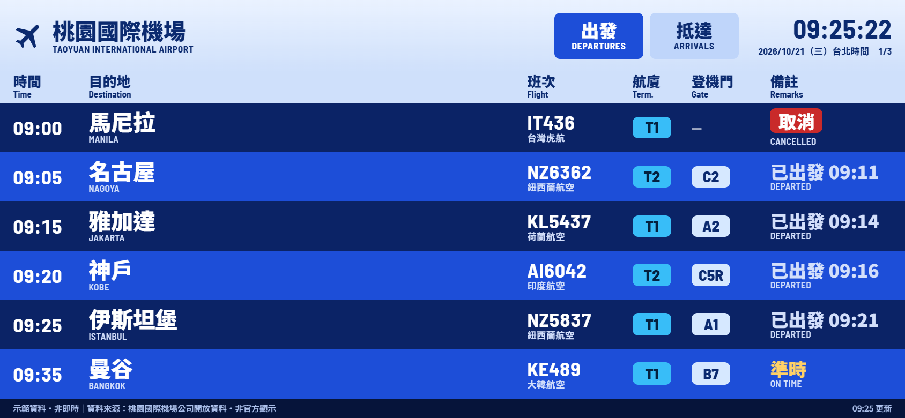
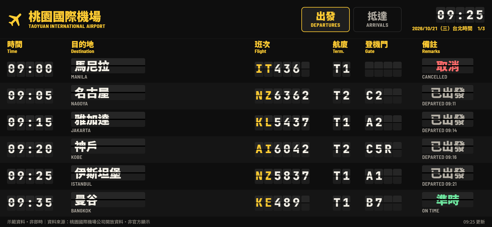

# 桃園機場航班看板

把閒置的手機橫放在桌上，變成桃園機場的即時航班看板。兩種風格可以切換：**藍板**（機場 LCD 看板）和**翻牌**（機械翻牌，換頁時每個字都會翻動）。





> 這是非官方的個人作品，航班資訊請以機場公告為準。

## 功能

- 出發和抵達自動輪播，共掛班號輪流顯示
- 我的航班：輸入班號（可以多班），畫面底部會顯示航廈、登機門、報到櫃台和倒數時間
- 全螢幕：按右下角的「全螢幕」，或從手機主畫面開啟；會防休眠、鎖橫向
- OLED 防烙印（畫面定時微移幾個像素），夜間自動調暗
- 時間一律用台北時間顯示，人在國外也不會錯亂

## 運作方式

桃園機場的開放資料是 Big5 編碼，沒有開放跨網域讀取，而且一次約 550 KB，所以手機不能直接抓。

`worker.js` 是一支 Cloudflare Worker，負責代抓官方檔案、刪掉 3 小時前的班次，結果快取 60 秒，壓縮後每次約 30 KB。看板本身是 `public/index.html`，每 5 分鐘向自己的 Worker 要一次資料，在手機上解碼與解析。

## 部署自己的一份

本專案只提供原始碼，不提供公開服務，請部署到自己的 Cloudflare 帳號。個人使用的流量遠低於 Workers 免費方案的額度。

1. 安裝 [Node.js](https://nodejs.org/)（建議 LTS 版）。
2. 下載本專案，在資料夾裡執行：

   ```
   npx wrangler login
   npx wrangler deploy
   ```

3. 部署完成會得到一個網址：`https://flight-board.<你的子網域>.workers.dev`。
4. 用手機開啟這個網址，按右下角的「全螢幕」即可。也可以加到主畫面，之後從主畫面開啟就是全螢幕：Android 用 Chrome 選單的「加到主畫面」；iPhone 的瀏覽器不支援全螢幕，請用 Safari 的「分享」→「加入主畫面」。

只想先看看效果的話，直接用瀏覽器開 `public/index.html`，會使用示範資料。

## 設定

點一下畫面，右上角會出現齒輪：

- 風格：藍板或翻牌（也可以在網址後面加 `?theme=flap`）
- 我的航班、每頁秒數、每側最多頁數
- 夜間調暗、鎖定橫向
- 資料來源：即時資料（預設 `/api/flights`）或示範資料

## 資料來源與授權

- 航班資料：[桃園國際機場即時航班](https://data.gov.tw/dataset/26194)，由桃園國際機場股份有限公司提供，依[政府資料開放授權條款](https://data.gov.tw/license)使用，約每 5 分鐘更新。
- 字型：Barlow Semi Condensed、Noto Sans TC、JetBrains Mono（Google Fonts，SIL Open Font License）。
- 程式碼：[MIT License](LICENSE)。
- 設計 token 與設計理由：[DESIGN.md](DESIGN.md)。
